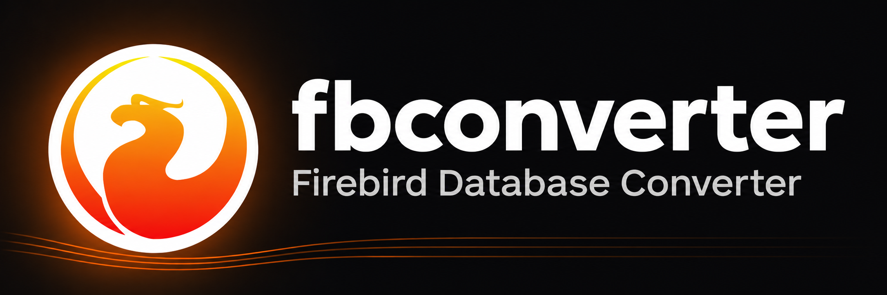

English | [Japanese](README.md)

# fbconverter

fbconverter is a Windows tool for migrating Firebird databases between versions. It reads the schema and data from the source database and creates a new database for the selected Firebird version. You can run conversions from the GUI, the command line, or a local MCP client over stdio.

## Download

Download the WIN32 or WIN64 ZIP from the [latest GitHub release](https://github.com/tomneko/fbconverter/releases/latest). Extract the entire archive, then run `fbconverter.exe`.

| Package | Included Firebird Embedded destinations |
| --- | --- |
| WIN32 | 1.5, 2.0, 2.1, 2.5, 3.0, 4.0, 5.0 |
| WIN64 | 2.1, 2.5, 3.0, 4.0, 5.0 |

Supported source servers include Firebird 1.0.3, 1.5, 2.0, 2.1, 2.5, 3.0, 4.0, and 5.0. Both packages include the CORE-2095 fix for `EUCJ_0208` in Firebird 2.1.7 Embedded. When connecting to a Firebird 2.1 source server with `EUCJ_0208`, the server also needs the patched `fbintl.dll`.

## CLI

This PowerShell example migrates a database from a Firebird 2.5 server to Firebird 5.0 Embedded.

```powershell
.\fbconverter.exe --convert --source C:\data\source.fdb --destination C:\data\migrated.fdb `
  --source-version 2.5 --destination-version 5.0 --source-host localhost `
  --source-charset SJIS_0208 --destination-charset UTF8 | Out-Host
$LASTEXITCODE
```

If the destination file already exists, fbconverter exits with code `2` and preserves the file. Set the source password with the `FBCONVERTER_SOURCE_PASSWORD` environment variable. [CLI options and logs](https://github.com/tomneko/fbconverter/wiki/English-v2#migrate-from-the-cli)

## MCP

Register the included `fbconverter_mcp.py` as a stdio server to call `convert_database` from an MCP client. It requires Python 3.11 or later and `uv`, and runs the `fbconverter.exe` in the same directory. [MCP configuration and tool arguments](https://github.com/tomneko/fbconverter/wiki/English-v2#use-an-mcp-client)

## Development

Build the Win32 and Win64 Release configurations with Delphi 13.1. Dependencies include Zeos 8.0-patches r8528 with the Firebird 1.0.3 compatibility patch, and AsyncCalls. [Build instructions and validation notes (Japanese)](dev_docs/ARCHITECTURE.md) · [English Wiki](https://github.com/tomneko/fbconverter/wiki/English-v2)

fbconverter is released under the [MIT License](LICENSE). The release ZIPs include dependency licenses, corresponding source code for fbconverter and the patched DLLs, and build instructions.
